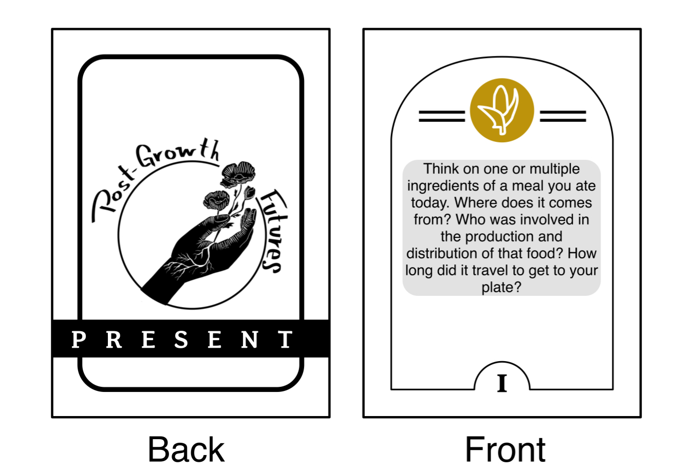

# About

*Postgrowth Futurism* is a collective imagination card game that invites us to evoke a brighter future past the [Capitalocene](https://en.wikipedia.org/wiki/Capitalocene). By using storytelling and collective imagination, we aim to draw the connections between the pillars that uphold our current global economy and answer the question: [What comes next?]{style="color:#801212;font-weight:bold"}  
Postgrowth futurism is a game for 1-6 participants played over 2 phases. In the case of having more than 8 participants, it is recommended to split the group into smaller groups so everyone in the group has enough time to participate. The estimated game time is 30-90 minutes.

*Postgrowth futurism* is inspired by the [post-fossil futures workshop developed by otros futuros](https://www.otrosfuturos.org/post-fossil-futures-workshop), the [Doughnut economics action lab work](https://doughnuteconomics.org/tools/doughnut-data-portraits-indicator-library#attachments), and the book [Everything for Everyone: An Oral History Of The New York Commune](https://www.commonnotions.org/buy/everything-for-everyone?srsltid=AfmBOopVeyxGhrHEQ9apTHa4fB2rMnwJYQvIQu-HaK6ik9aPz5dsmZ5N). 

# Instructions

*Postgrowth Futurism* consists of a deck of cards that provides a series of questions to spark discussions about our economic systems and aspects of our life that builds our concept of well-being. The game consists of two phases: I) [Present]{style="color:#801212;font-weight:bold"} and II) [Future]{style="color:#801212;font-weight:bold"}. 
Each phase has an associated deck of cards. In each phase, the participants take turns drawing a card to read the question and provide an answer. The questions asks the participants to share personal stories to explore different themes. Participants who are not as comfortable sharing personal stories are invited to role play fictional characters with the intention to illustrate the different dimensions covered by the game. Depending on the group size, each phase will consist of 1-3 rounds where each person draws a card.  

For this first edition of the game, the cards cover 5 major dimensions:

## I) Present (Storytelling)
It is important to place ourselves in the current reality we live. We all have different life experiences under the same systems of oppression. The first phase of the game is intended to explore this trough storytelling. For each round, the group will take turns on drawing a card from the [Present]{style="color:#801212;font-weight:bold"} deck.

## II) Future (Collective imagination)
For the second part we will travel to the future. A future past all the current global crisis where we took a leap past the struggle. A future where we figured out the solutions to the biggest challenges we are currently facing, and our collective human needs are met. We will use collective imagination and world building to describe how that world looks like. If it helps, we can imagine how we got there, but most importantly, we will focus on how does it looks like and how does it feels. Participants are encouraged to build on each others responses and ask related questions to each other.
During this stage of the game, participants are encouraged to reflect on what are the seeds for those future that exist today.

